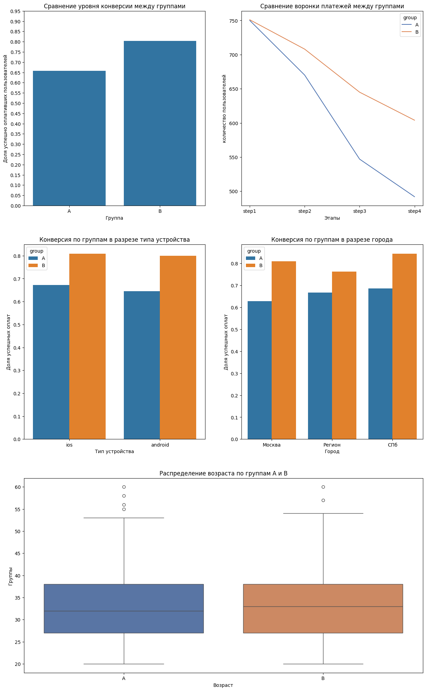

# Отчет по результатам A/B теста новой формы оплаты ЖКХ

## 1. Контекст и цель тестирования

**Цель:** Оценить влияние новой формы с автозаполнением реквизитов на долю успешных оплат ЖКХ.
**Ключевая метрика:** Конверсия из шага 1 (Открыл форму оплаты) в шаг 4 (Успешная оплата).
**Длительность теста:** 30 дней (1–30 апреля 2024 года).

## 2. Разведочный анализ (EDA) и обработка аномалий

В процессе первичного анализа двух исходных таблиц были обнаружены и обработаны следующие аномалии:

- **Отсутствующие ID и группы:** Выявлено несколько пользователей (1-2), у которых отсутствовала принадлежность к группе и городу. Также найден 1 платеж, не привязанный ни к одному `user_id`. Эти записи были отфильтрованы, чтобы не искажать результаты теста.
- **Множественные оплаты:** Выявлено, что записей в платежах значительно больше, чем уникальных пользователей. У некоторых клиентов количество попыток оплат превышало 1 раз за месяц. **Решение:** Если пользователь совершал несколько попыток, успехом считалось наличие *хотя бы одной* успешной оплаты за период теста.

## 3. Проверка сопоставимости групп

Перед анализом конверсии была проведена проверка корректности работы системы сплитования. Выборки сравнивались по ключевым признакам.

* **Город и Тип устройства (Категориальные признаки):** Использовался критерий Хи-квадрат Пирсона.
  * *Город:* p-value = 0.440 > 0.05
  * *Устройство:* p-value = 0.056 > 0.05
* **Возраст (Непрерывная величина):** Использовался T-критерий Стьюдента.
  * *Возраст:* p-value = 0.824 > 0.05

**Вывод:** Разбиение на группы абсолютно случайное, без статистически значимых перекосов по какому-либо из признаков. Группы А и В полностью сопоставимы.

## 4. Результаты A/B теста и Статистическая проверка

**Гипотезы:**

* **H0 (Нулевая гипотеза):** Разница в конверсиях — это случайное совпадение, упрощение заполнения реквизитов не влияет на успех оплаты.
* **H1 (Альтернативная гипотеза):** Новая форма статистически значимо повышает конверсию в успешную оплату.

**Сравнение метрик:**

* Конверсия контрольной группы А: **65.7%**
* Конверсия тестовой группы В: **80.4%**
* Абсолютная разница: **+14.7 п.п.**

Для оценки значимости применялся **Z-критерий для пропорций (Z-test)**. Обоснование выбора метода: бинарная метрика (оплата прошла/нет), независимость групп и достаточный размер выборок (~750 человек в каждой).

**Результат стат. теста:**
Полученное значение $Z = 6.40$ соответствует $p < 0.001$, что позволяет уверенно отклонить H0. 95%-й доверительный интервал разницы конверсий не включает ноль.

## 5. Визуализация результатов

Графики ниже показывают, что новая форма оплаты в тестовой группе В дает равномерный прирост конверсии во всех сегментах воронки:

## 6. Финальный вывод и рекомендация

Разница в 14.7 п.п. практически значима: в тестовой группе В на каждые ~750 пользователей приходится примерно на 110 больше успешно оплативших ЖКХ по сравнению со сценарием группы А.

**Рекомендация продуктовой команде:**
Гипотеза полностью подтвердилась. Новая форма с автозаполнением реквизитов статистически значимо увеличивает долю успешных оплат. **Рекомендуется раскатить новую форму на 100% пользователей.**
